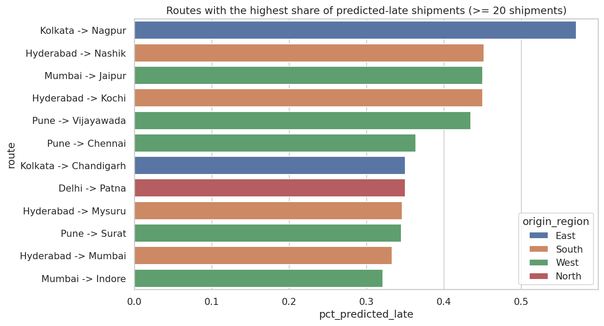
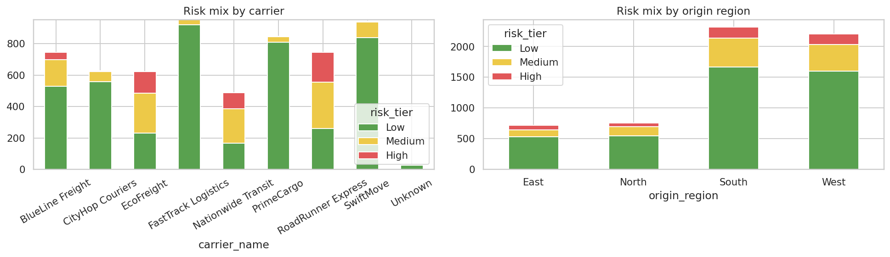

# Delivery Route Delay Forecasting - Final Report
*Axlero DA Internship, Project 3 (Logistics & Supply Chain). Data: synthetic shipments, 30,000 deliveries across 8 origin warehouses, 22 destination cities and 8 carriers, Jan 2024 - Dec 2025.*

## 1. Business problem
Logistics partners pay penalties when deliveries breach their SLA. If operations managers know **before dispatch**
which shipments will likely run late, they can re-route, switch carrier or warn the customer.
We predict `hours_delayed = actual delivery hours - SLA hours` (negative = early) and flag high-risk shipments.

## 2. Headline results
| Objective | Target | Achieved |
|---|---|---|
| Rows dropped in cleaning | (internal: minimise) | 0.40 % (120 exact duplicates only) |
| Distance from raw lat/lon | Haversine | `math`-module implementation, unit-tested |
| Forecast accuracy | R2 >= 0.65 or minimised RMSE | **R2 = 0.672**, **RMSE = 1.52 h**, MAE = 1.02 h |
| Lift vs naive | - | RMSE 48 % lower than "trust the SLA" (2.93 h) |

## 3. Data wrangling (Week 1)
Raw extract problems and fixes - nothing was deleted that could be repaired:
| Problem | Count | Fix |
|---|---|---|
| Exact duplicate rows | 120 | removed in SQL (`DISTINCT`) |
| Delivery timestamp earlier than dispatch | 240 | swapped |
| Year typo (delivery 2026 vs 2025) | 46 | corrected by -1 year after plausibility check |
| Destination lat/lon transposed | 299 | swapped back |
| Impossible coordinates | 90 | replaced by destination-city median |
| Missing weight / carrier | 450 / 150 | vehicle-type median / `UNKNOWN` |
| Four mixed timestamp formats | all rows | parsed with explicit formats (no day/month ambiguity) |

Distances use the Haversine formula implemented with the standard `math` module.

## 4. What drives delays (Week 2)
Overall **17.1 %** of shipments breach their SLA. Late rates:
* **Season:** about 10 % in Jan-May vs 19-27 % in Jun-Nov (monsoon, then the Oct-Nov festive peak).
* **Day of week:** Saturday 22 % and Friday 22 % vs Sunday, Wednesday and Thursday about 14 %.
* **Dispatch hour:** 17:00-23:00 dispatches run 21-29 % late vs about 15 % in daytime.
* **Carrier:** C08 44 %, C04 36 %, C06 34 % vs C01 5 % and C05 5 %. C04's performance also *drifts worse over time*.
* **Weather:** shipments dispatched on rainy days (>= 2.5 mm) average -0.04 h vs SLA, versus -1.84 h on dry days.

## 5. Regression model (Week 3)
**Setup:** One-Hot Encoded categoricals; hyper-parameters tuned with `GridSearchCV` + `TimeSeriesSplit` on the training
period; **chronological hold-out** (train 24,000 shipments to 2025-08-24, test 6,000 shipments after).

| Model | Test RMSE (h) | Test MAE (h) | Test R2 (delay) |
|---|---|---|---|
| **Random Forest** | **1.52** | **1.02** | **0.672** |
| Ridge Regression | 2.23 | 1.54 | 0.296 |
| Baseline: predict mean delay | 2.71 | 1.82 | -0.039 |
| Baseline: "trust the SLA" | 2.93 | 2.19 | -0.214 |

**Important note on R-squared.** The brief asks for R2 on *total delivery hours*. We report it (RF 0.997, Ridge 0.994),
but it is **not a meaningful test**: even the naive "trust the SLA" baseline scores 0.990, because total time is dominated
by distance. The stricter number is R2 on **hours delayed** (0.672) and RMSE versus baselines, so that is our headline.

Random Forest wins because delay depends on interactions (rain x distance, carrier x season) that a linear model cannot capture.

**Top drivers (permutation importance):** recent vendor performance (rolling delay of previously delivered shipments),
SLA length, distance, dispatch hour, day of week, rainfall, festive season.

**Residual analysis.** Residuals centre near zero and show no strong trend against prediction or distance, but we found
two mild biases worth stating:
* **Carrier C04 is under-predicted by about +0.78 h** on average in the test period - its performance keeps worsening
  over time, faster than the training period showed. (Carrier "UNKNOWN", only 29 shipments, shows +0.89 h.)
* **Saturday** dispatches are under-predicted by +0.56 h; Sunday over-predicted by -0.31 h.
* Large positive residuals come mainly from random breakdowns, which no dispatch-time feature can predict.
Recommended fix: retrain regularly (monthly) so drifting carriers are re-learned.

**As a late-shipment alert** (predicted delay > 0): precision 0.78, recall 0.58.

## 6. Operations dashboard (Week 4)
Predicted delay is converted to risk tiers (predicted hours vs SLA): **Low** < -0.5 h, **Medium** -0.5 to 1 h, **High** >= 1 h.
On the test period the tiers behave as intended:

| Tier | Shipments | Actually late |
|---|---|---|
| Low | 4,343 | 7.5 % |
| Medium | 1,169 | 46.3 % |
| High | 488 | **92.4 %** |

The dashboard ranks routes by predicted-late share and lets a dispatcher filter by region and carrier; the worklist lists
high-risk shipments with the largest predicted delay first. Note that some routes have only 20-30 shipments in the test period,
so route rankings are indicative, not definitive.

## 7. Recommendations
1. Intervene on **High-tier** shipments first: 92 % of them really are late, so alerts are precise enough to act on.
2. Review **C08, C04 and C06** (late rates 34-44 %) and reassign time-critical lanes to C01/C05.
3. Add buffer to SLAs for **evening/night dispatches, Fridays/Saturdays and Jun-Nov**, or schedule dispatch earlier in the day.
4. Check rain forecasts at dispatch; heavy-rain days add the most delay on long routes.
5. **Retrain monthly** and monitor residuals by carrier; add a breakdown / fleet-age feed to reduce the unpredictable tail.

## 8. Limitations
* Data is simulated; real-world accuracy must be re-validated on client data.
* Weather uses the origin city only (no route weather).
* The test period (Aug-Dec) includes the festive peak, which is a harder-than-average window.
